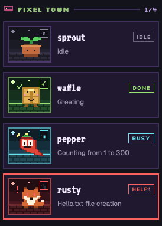

# herdr-critters

A Herdr desktop app mod: the Agents sidebar as cards with a critter for each
agent. The look is a theme: retro pixel art, an Edo woodblock print, glossy
Y2K or neon cyberpunk.

- One card per agent: a sprite, the agent's name with its status box (the
  theme's word, for example `IDLE`, `BUSY`, `HELP!`, `DONE` in retro) beside
  it, and the session name under it (else the tab).
- Every agent gets a name from a list of 30 (4 to 7 letters, `names` in the
  theme), kept across restarts and never two the same. Each name is a
  character with its own sprite.
- Each sprite has one picture per status: idle (eyes shut), working (a bolt),
  blocked (a `!` and a sweat drop), done (happy eyes and a check). The sprite
  box background and border follow the status too.
- Cards are grouped by machine or by space: click `BY MACHINE` / `BY SPACE` in
  the panel header. Each group header shows `busy/total`. A space header uses
  the space's color from the Spaces list.
- The corner badge moves: `z` when idle, a spinner when working, a blinking `!`
  when blocked, a check when done. Working sprites bob.
- Click a card to focus its pane. Hover to pin or unpin.
- Click a group header to collapse the group to its header line. Hover a
  card and click `-` to make it one thin line; `+` opens it again.
- Right-click a card for a menu: pin, collapse the card, collapse its group.
- A narrow sidebar (under 160 px) shows only the sprite boxes.
- The look is a theme (see [Themes](#themes)). The header button next to
  `BY MACHINE` shows the active theme (`RETRO`); click it to switch to the next.


## Install

Ask your Herdr agent:

> Read ~/.config/herdr-app/AGENTS.md, then add this layout: https://github.com/izerozlu/herdr-critters

To use only the mod in a layout of your own, set that layout's agents block to
`"content": { "mod": "herdr-critters" }`.

## Develop

```sh
./install.sh
```

This copies `mods/herdr-critters`, `mods/pane-collapse` and
`mods/pane-collapse-menu` to `~/.config/herdr-app/mods/` and runs
`herdr-app check` on each. It also adds the keys in `keys.json` to your
`keys.json`, but never replaces a key you already bound. Herdr reloads the
mods live. Run it again after every change. A symlink does not work: Herdr
does not load a mod's images through one.

`RECIPE.md` is the brief another agent builds the mod from. Update it and
`preview.png` when the mod changes.

## Themes

Seven themes ship. Each has its own names and critters (30, or 12 in noir,
deepsea and garden), colors, scenes, status words and fonts.

| Theme | Look | Status words | Fonts |
| --- | --- | --- | --- |
| `retro` (default) | Dark pixel arcade: pixel critters, a dusk sky over bricks. | `IDLE` `BUSY` `HELP!` `DONE` | Silkscreen, VT323 |
| `edo` | An ukiyo-e woodblock print on washi paper: Japanese food and objects as vector critters with an ink outline. | `IDLE` `BUSY` `HELP!` `DONE` | Shippori Mincho, Yuji Syuku |
| `y2k` | Glossy Aqua, about 2000 to 2005: vector critters with a white shine, a wallpaper sky over green hills, a light silver panel. | `BRB` `SYNC` `OMG!` `W00T` | Orbitron, Share Tech Mono |
| `noir` | A 1940s detective city at night: 12 critters in costume as black cutouts against an office window with venetian blinds, all grays with one blood red. Raster PNG art. | `QUIET` `SNOOP` `HEAT!` `SOLVED` | Silkscreen, VT323 |
| `deepsea` | A bioluminescent deep sea at night: 12 sea creatures as soft see-through gel that glows from inside, over dark water with light shafts. | `DRIFT` `DIVE` `SOS!` `DOCK` | Silkscreen, VT323 |
| `garden` | A light cottage garden as a felt craft toy: 12 garden bugs and small animals in puffy matte felt with running stitches, felt hills and flowers. | `REST` `GROW` `WILT!` `BLOOM` | Silkscreen, VT323 |
| `cyber` | Neon cyberpunk: cute vector mascots (cyborg animals, drones, androids, hackers) with holo chrome and neon lights, a night city skyline over a grid floor. | `AFK` `HACK` `PING!` `SYNC` | Orbitron, Share Tech Mono |

### How theming works

A theme is data. `main.js` draws the view and reads every color, word, font,
name and art path from the active theme object. It never hard-codes a look.

- `themes/<id>/theme.js` holds the data (see `RECIPE.md` `## Themes` for the
  keys).
- `themes/<id>/art/` holds the pictures the view shows (SVG, or PNG for noir):
  the sprites, scenes and icons.
- `themes/index.js` lists the themes. The header button cycles through them.

Everything look-related lives in `mods/herdr-critters/themes/<id>/`:

```
mods/herdr-critters/
  main.js
  fonts/              shared by all themes
  themes/
    index.js          registry (THEMES, DEFAULT_THEME, themeById)
    retro/
      theme.js        colors, scenes, status words, names, fonts, art path
      art/            the SVGs (PNGs for noir, deepsea, garden)
    edo/              same layout
    y2k/              same layout
    noir/             same layout
    deepsea/          same layout
    garden/           same layout
    cyber/            same layout
```

The chosen theme id is shared state (`herdr-critters.theme`). A missing or
unknown id falls back to `retro`. Retro keeps its names in `localStorage` key
`names`; other themes use `names.<id>`.

### Add a theme

1. Copy `themes/retro/theme.js` to `themes/<id>/theme.js`. Change `id`, `label`,
   `art` and the values. Keep every key. `namesKey` is optional: it sets where
   the picked names are stored (default `names.<id>`; retro keeps `names`).
2. Add the art in `themes/<id>/art/` (`sprite-<name>-<status>.svg` for every
   name, `scene-<status>.svg`, `icon-machine-<scene>.svg` for every scene,
   `icon-dither.svg`). Make them with an art package (see [Art](#art)). For
   PNG art, the same names end in `.png`, and `theme.js` sets `artExt: "png"`.
3. Import it in `themes/index.js` and add it to `THEMES`. The order is the
   cycle order of the header button.

## Art

`art/generate.py` writes a theme's art to `mods/herdr-critters/themes/<id>/art/`
from the Python package `art/themes/<id>/`. A package draws in one of three ways:

- **Pixel grids** (retro): the package exports ASCII grids, one character per
  pixel, and per-status poses. The engine turns them into SVG and adds the
  status marks. See the `generate.py` docstring for the names a package exports.
- **Vector** (edo, y2k, cyber): the package sets `VECTOR = True` and draws the SVG
  text itself: `SPRITES` maps a name to a function of the status, and `SCENES`
  and `ICONS` map a name to SVG text. Each vector package has a `kit.py` with
  one face engine, so every critter poses the same way. Edo draws woodblock
  shapes with an ink outline. Y2k draws glossy bodies with a white shine: a
  `Critter` gives its body and face position, and the kit adds the eyes, mouth,
  blush and status marks. Cyber draws flat mascots with an ink outline, cel
  shadows, holo gradients and neon glows: each critter is a function of the
  status, and the kit gives it the eyes, mouth and status marks.
- **Raster**: the package sets `RASTER = True` and draws PNG files with any
  Python engine (Pillow, skia-python, pycairo). `SPRITES`, `SCENES` and `ICONS`
  work as for vector, but give PNG bytes, and the files end in `.png`. Set
  `artExt: "png"` in the theme's `theme.js` so the mod loads them. Draw sprites
  at 2x (320 x 256) and scenes at 576 x 480, so they stay sharp. Noir draws
  black cutout critters with skia-python: a `Critter` gives its silhouette, its
  few pale or red details and its face position, and the kit adds the backlight
  rim, the eyes, the mouth and the status marks. Deepsea draws soft gel with
  skia-python: a `Critter` is a list of parts (gel shapes, thick limbs, thin
  glowing strands) and its face position, and `kit.py` adds the glow, the face
  and the status marks. It saves 256-color PNGs with libimagequant
  (`imagequant`), so the files stay small. Garden draws felt with Pillow and
  numpy: its `kit.py` paints each shape as a felt piece (fuzzy edge, soft
  shadow, matte puffy shading, a running stitch) and holds the face engine; each
  batch file gives a critter's felt pieces and face position.

Edit the art, then:

```sh
uv run --no-project art/generate.py --theme <id>     # default: retro
./install.sh
```

A raster theme needs its engine: add it with `--with`. Noir:
`uv run --no-project --with pillow --with skia-python art/generate.py --theme noir`.
Deepsea also needs imagequant:
`uv run --no-project --with pillow --with skia-python --with imagequant art/generate.py --theme deepsea`.
Garden: `uv run --no-project --with numpy --with pillow art/generate.py --theme garden`.

`art/preview.py` draws a sheet of every sprite in every pose
(`art/preview-sprites.png`). Vector themes also need resvg; raster themes need
only Pillow:

```sh
uv run --no-project --with pillow art/preview.py --theme retro
uv run --no-project --with pillow --with resvg-py art/preview.py --theme y2k out.png
```

## Fonts

Retro, Noir, Deepsea and Garden use Silkscreen and VT323. Edo uses Shippori Mincho and Yuji Syuku, cut
to the Latin letters with `pyftsubset` so the files stay small. Y2k and cyber
use Orbitron and Share Tech Mono. All are under the SIL Open Font License (see
`mods/herdr-critters/fonts/LICENSE-*.txt`).
Herdr loads them from the mod's `fonts/` folder.

## Extras

Extra tools that ship with the `critters` layout, beside the agents
sidebar. `install.sh` installs them with the mod.

### Pane collapse

The layout can hide a pane and keep its program running.

- Right-click a pane, then pick **Collapse pane**. It acts on the pane you
  clicked, not the focused one. The card menu has **COLLAPSE PANE** too.
- `cmd-shift-c` collapses the focused pane.
- `cmd-shift-e` puts back the last pane you collapsed in this tab.
- A collapsed agent stays in the sidebar as a collapsed card in its group.
  Click the card (or its `+`) to put the pane back. Its menu says
  **EXPAND PANE**.
- A chip shows at the bottom right of the tab too. Click it to put the pane
  back. You can drag the chips to another edge.

Chips show the panes collapsed from the tab you are looking at. A pane whose
tab was closed shows in every tab; its chip puts it next to the focused pane.
A tab's only pane can't collapse.

| Path | What it is |
| --- | --- |
| `mods/pane-collapse/` | the chips (a floating block on `main`) and the key commands |
| `mods/pane-collapse-menu/` | a copy of the shipped terminal menu with **Collapse pane** added; the layout's `terminal_menu` |
| `mods/*/collapse.js` | the collapse and restore logic; the same file in `pane-collapse`, `pane-collapse-menu` and `herdr-critters` |
| `keys.json` | the keys, for the `critters` layout only |

Mods can't import from another mod's folder, so `collapse.js` is copied into
three mods. Keep the copies the same; `install.sh` stops if they differ.

Herdr has no command to shrink a split. So "collapse" parks the terminal
(`terminal.park`): its pane goes away and the program keeps running. Before
that, the mod reads the tab's split tree (`doc.get` of the `herdr-app`
document through `hc connect`) and saves where the pane sat, in shared state
`pane-collapse`. To restore, it selects the tab, focuses the pane it sat next
to, runs `terminal.keep` with `place` right or down, and, if the pane was on
the left or top, `pane.swap`s it back.

A parked terminal leaves `agents()`. The critters mod adds it back from the
`pane-collapse` records and `terminals()`, after the last agent of its space.

Limits:

- Split sizes are not kept. The restored pane gets half of its neighbor.
- The place is exact when the neighbor was a single pane. When the neighbor
  was a group of panes, the pane comes back inside that group.
- A parked terminal has core keep off. If herdr-core restarts, a collapsed
  terminal is lost, and its card and chip go away.
- The menu is a copy of the shipped `menu` from Herdr 0.1.12. Herdr updates
  don't change it.

## Limits

- The palette is fixed per theme. It does not follow the Herdr theme.
- Past 30 agents, names repeat with a number (`pixel 2`) and share a sprite.

## Thanks

Kudos to [typecraft](https://x.com/typecraft_dev/status/2117399278197108821)
for the inspiration.
