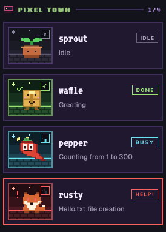

# Herdr critters

The Agents sidebar as retro pixel cards. Every agent is a small named critter
with its own sprite, standing in a pixel scene that changes with its status.

## What you see

The mod fills the layout's `agents` block, top to bottom:

- **Header** (38 px): a dither icon, `AGENTS` in Silkscreen 11 px `#6b6f82`, a
  `BY MACHINE` / `BY SPACE` toggle (Silkscreen 9 px, 1 px `#34364a` border), and
  on the right `N BUSY` (cyan `#5ee6f2` when any agent works, else gray).
- **Group headers** (30 px): a 15x11 machine icon, the group label in bold
  Silkscreen 11 px, a 2 px rule, and `busy/total`. By machine the label is
  `THIS MACHINE` or the machine name; by space it is the space name in capitals,
  in the space's color from the Spaces list.
- **Cards**, 8 px apart, 10 px side padding: a 2 px border, the scene's card
  color as fill. Left is a 74x62 sprite box; right is the name (VT323 20 px,
  `#f1ecff`) with a status box beside it (Silkscreen 10 px, 1 px border,
  17 px high), and under it the session name (11.5 px, `#9a95b0`).
- **Sub-agents**: 22 px rows under their parent, indented 10 px per level:
  `└`, the name, the status word in Silkscreen 8 px.
- **Empty**: `NO PLAYERS YET` in orange and one line of help.
- **Narrow sidebar** (sidebar under 160 px wide): only 36x30 sprite boxes in a
  column, the focused one with an orange border.

Background `#12131b`. The palette is fixed and does not follow the theme.

Scenes by machine: this machine is `dusk` (purple), other machines take `den`
(blue-gray), `dawn` (rust) and `moss` (green) in turn.

## How it behaves

- **Names**: each agent gets a random name from a list of 30 (pixel, byte,
  nova, rook, ziggy, mochi, bolt, echo, juno, kiwi, luma, miso, nimbus, onyx,
  pepper, quill, rusty, sprout, tango, umbra, vega, waffle, yeti, zephyr, comet,
  dusty, fable, gizmo, hopper, ivory). The pick uses `crypto` random, never two
  the same, and is kept in `localStorage` by agent address across restarts.
  Past 30 agents a name repeats with a number (`pixel 2`) and shares a sprite.
- **Status**, on the status box, sprite, scene and corner badge:
  - idle: `IDLE` gray, eyes shut, badge `z`/`Z` blinking.
  - working: `BUSY` cyan, a yellow bolt, badge a 4-frame spinner, the sprite
    bobs 3 px.
  - blocked (and error): `HELP!` red, red eyes, a red `!` and a sweat drop,
    badge `!` pulsing, the card border red.
  - done: `DONE` green, happy eyes, a green check, badge `✓`.
- The focused agent's card has an orange `#e8922e` border.
- Click a card to focus its pane (`pane.focus`). Hover shows a pin button; it
  runs `terminal.pin`. Pinned agents go first in their group.
- Click a sub-agent row to peek at it (`terminal.peek`).
- The group toggle is shared state (`herdr-critters.group`).
- The mod sets the agent order (`setAgentOrder`) to the order it shows.

## Built from

- **Layout** `layouts/critters.json`: the shipped `main` layout with the
  `agents` block set to `{ "mod": "herdr-critters" }`.
- **Mod** `mods/herdr-critters/`: `main.js` (one `View`), `mod.json`
  (`place: none`), `art/`, `fonts/`.
- **herdr functions**: `agents`, `terminals`, `spaces`, `machines`, `layout`,
  `theme`, `shared`, `setShared`, `setAgentOrder`, `run`.
- **Commands**: `pane.focus`, `terminal.pin`, `terminal.peek`.
- **Shipped mods it uses**: the `pin` and `pin-off` icons of
  `workspace-chrome`.
- **Programs, network, files**: none. It does not run programs, reach the
  network or read files outside its own folder.
- **Art**: SVG pixel art in `mods/herdr-critters/art/`: one sprite per name and
  status (`sprite-<name>-<status>.svg`), a scene per status, machine icons and a
  dither icon. Made from ASCII grids by `art/generate.py`.
- **Fonts**: Silkscreen and VT323 (SIL Open Font License) in `fonts/`.
